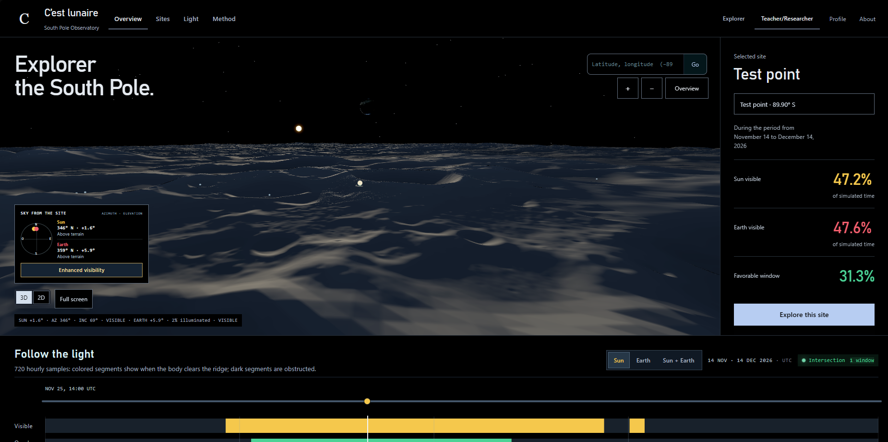
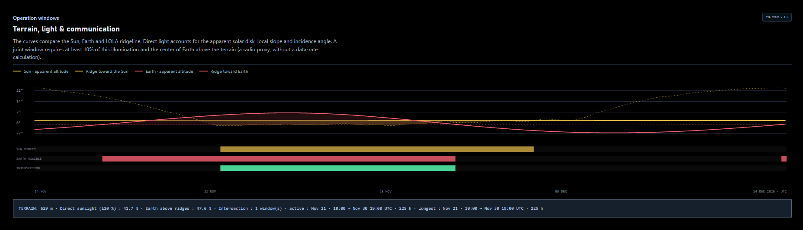
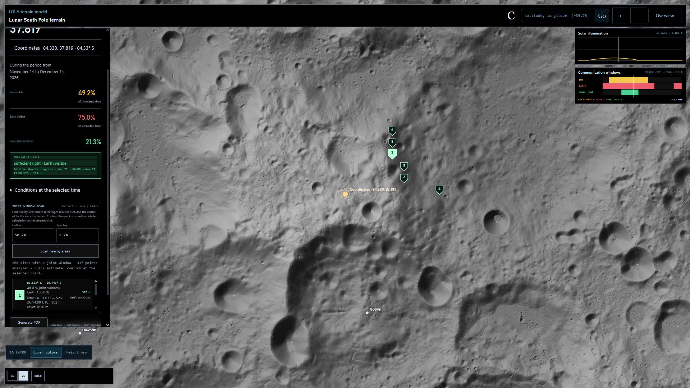

# C’est Lunaire

An interactive lunar South Pole observatory built for the NASA Space Apps Challenge.


## 1. Problem

At the lunar South Pole, the Sun often sits low on the horizon. A nearby ridge can block direct sunlight, while the slope of an illuminated surface affects how much light it receives. Terrain can also obstruct the line of sight toward Earth. Comparing these conditions over time helps explain why nearby sites can offer different opportunities for solar-powered activities and direct-to-Earth communication.

## 2. Solution

C’est Lunaire lets you select a named site, enter coordinates, or click the map to inspect local terrain and sky conditions over 720 hourly samples from **14 November to 14 December 2026 (UTC)**.

- Explore 3D terrain with a moving **12 km × 12 km patch at 30 m spacing**, or switch to tiled 2D shaded relief and elevation maps.
- Compare the Sun and Earth’s altitude and azimuth with the local ridgeline. Scrub time to see changes in visibility, direct illumination, and joint operating windows.
- Use **Zone Analysis** to scan nearby terrain and rank candidate sites by qualifying hours, using the longest continuous window to break ties.
- Explore with the driveable rover or use **Teacher/Researcher mode** to inspect the horizon profile and export selected-site results as CSV or PDF.

## 3. Scientific methodology

### 1. Place the observer on the Moon

The app converts the site’s latitude and longitude to a south-polar stereographic map. For latitude $\varphi$ and a reference lunar radius of $R = 1{,}737.4\,\text{km}$, the projected distance from the pole is

```math
\rho = 2R \tan\left(\frac{\pi}{4} + \frac{\varphi}{2}\right)
```

The app interpolates the four surrounding LOLA elevation samples to estimate the site’s height, then adds that height to the reference radius to place the observer.

### 2. Calculate the local sky

JPL’s DE421 ephemeris supplies the hourly positions of the Sun and Earth. To find where each body appears from the selected site, the app subtracts the site’s position from the body’s position. The result is a vector pointing from the observer toward that body.

The app scales this vector to unit length, then measures how much it points **east**, **north**, and **up** relative to the site. These three components describe the direction in the observer’s local sky.

**Altitude** tells you how high the body appears above the local horizontal. An altitude of 0° is level with the observer, while 90° is directly overhead. The `up` component is measured along the local vertical.

```math
\text{altitude} = \arcsin(\text{up})
```

**Azimuth** tells you which way to turn to face the body. It is measured clockwise from north, so north is 0°, east is 90°, south is 180°, and west is 270°. The app uses both horizontal components to find the bearing and wraps the answer into the 0°–360° range.

```math
\text{azimuth} = \text{atan2}(\text{east}, \text{north})
```

These angles tell the app where to look. The next step checks whether terrain blocks the view by comparing the body’s altitude with the ridgeline at that azimuth.

### 3. Build the terrain horizon

- **Horizon.** The app traces 360 compass bearings and samples the terrain every 30 m out to roughly 100 km. It accounts for the Moon’s curvature and keeps the highest apparent terrain angle along each bearing. It interpolates between bearings to estimate the horizon in the direction of the Sun or Earth.
- **Local slope.** The app compares elevation samples 225 m to the east, west, north, and south of the site to estimate which way the ground faces.

### 4. Estimate direct sunlight

The app estimates how much of the solar disk clears the ridge. It then adjusts for the incidence angle, measured between the direction to the Sun and the direction perpendicular to the ground.

```math
\text{direct light (\%)} = 100 \times \text{visible disk fraction} \times \max\left(0, \cos(\text{incidence angle})\right)
```

### 5. Find joint operating windows

An hour qualifies when both conditions are met.

- Direct illumination reaches at least **10%**.
- Earth’s center is above the terrain horizon.

Consecutive qualifying hours form a joint operating window. **Zone Analysis** compares nearby candidates using 72 bearings and 500 m steps. Selecting a candidate runs the detailed calculation at that location.



## 4. NASA resources

| Resource | How the app uses it |
| --- | --- |
| **LRO LOLA `LDEM_75S_30M`** | Native elevation input for 3D terrain, site height, local slope, and horizon calculations. The signed samples encode 0.5 m per count. The repository includes 3,600 lossless tiles and an averaged overview. [NASA PDS LOLA archive](https://pds-geosciences.wustl.edu/lro/lro-l-lola-3-rdr-v1/lrolol_1xxx/data/lola_gdr/polar/img/) |
| **LRO LOLA `LDEM_75S_60M`** | Source for the shaded-relief and elevation map layers. [NASA PDS LOLA archive](https://pds-geosciences.wustl.edu/lro/lro-l-lola-3-rdr-v1/lrolol_1xxx/data/lola_gdr/polar/img/) |
| **JPL DE421 and lunar orientation** | Source and reference frame for the bundled hourly Sun and Earth vectors. [NASA’s DE421 lunar frame overview](https://svs.gsfc.nasa.gov/4969/) |
| **NASA Blue Marble** | Earth globe texture used for display. [NASA Earth Observatory](https://science.nasa.gov/earth/earth-observatory/blue-marble-next-generation/base-map/) |



*The 2D shaded-relief map, derived from 60 m LOLA data.*

Named lunar landmarks use the [USGS Gazetteer of Planetary Nomenclature](https://planetarynames.wr.usgs.gov/).

## 5. Validation

- **Sky geometry.** A Skyfield calculation using DE421 checked all 720 hourly positions at three sites. Maximum differences in altitude or azimuth were below **0.008 arcseconds for the Sun** and **0.10 arcseconds for Earth**.
- **Terrain and windows.** An independent calculation from the raw LOLA raster agreed with the app’s horizons to within **0.000001°** at those sites and reproduced the same joint windows. The sites had **0 qualifying hours** at Shackleton (89.67°S, 129.78°E), **150** at 89.85°S, 45°E, and **166** at 85°S, 0°E.
- **Browser smoke test.** Checked onboarding, 3D startup, both 2D layers, the sky scale toggle, and coordinate selection with detailed analysis.

These comparisons verify implementation agreement for the cases tested. Terrain grid spacing, interpolation, bearing resolution, the 100 km horizon cutoff, and hourly sampling all limit the results. The Earth-center condition is a geometric communication proxy. It provides no signal strength, data rate, or link budget. The simulated month cannot establish permanent shadow or the presence of ice.

## 6. Impact

Students and educators can connect lunar topography with sunlight and Earth visibility. Researchers and mission-design teams can use the app to compare sites and identify candidates for further analysis. The maps, charts, and exports let users inspect why a site ranked well and share the assumptions behind the result.

## Run locally

Install Python 3 and use a browser with WebGL and gzip DecompressionStream support.

**Windows:** Open the project folder in File Explorer and double-click **Start Cest Lunaire.cmd**. The launcher finds `server-local.py` next to itself, wherever you saved the folder.

**Terminal:** Open a terminal in the folder that contains `server-local.py`. On Windows, you can open that folder in File Explorer, right-click an empty area, and choose **Open in Terminal**. Then run:

```sh
python server-local.py
```

If your system uses `python3` or the Windows `py` launcher, use `python3 server-local.py` or `py -3 server-local.py`. The server opens the app in your browser. Keep the terminal open while using it.

The repository includes the processed tiles, compiled CSS, and Three.js. Node.js and npm are only needed to rebuild the stylesheet with `npm install` and `npm run build:css`, from the same project folder.
